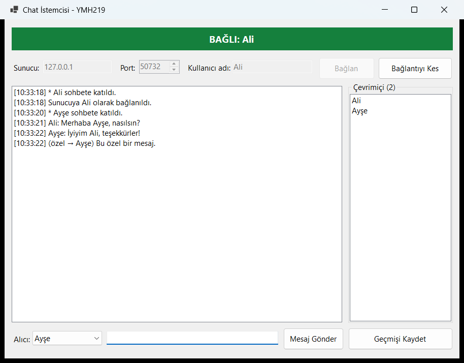
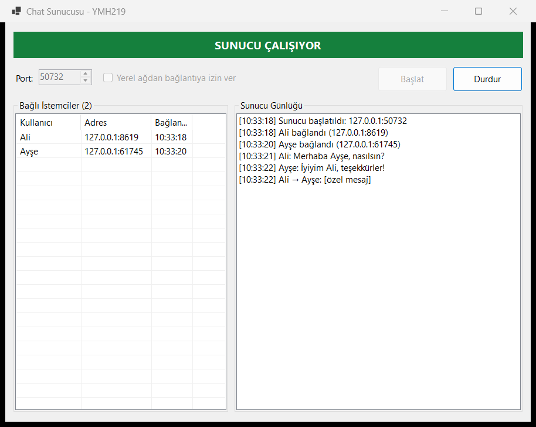

# İstemci-Sunucu Chat Uygulaması

TCP üzerinden birden fazla kullanıcının aynı odada mesajlaşabildiği, Windows Forms arayüzlü bir sohbet sistemi. Sunucu ve istemci ayrı uygulamalardır; ortak protokol ve ağ kodu `ChatApp.Core` kütüphanesindedir.

YMH 219 Nesne Tabanlı Programlama dersi uygulama ödevidir.

## Kullanılan Teknolojiler

- C# / .NET 9
- `TcpListener`, `TcpClient`, `StreamReader`, `StreamWriter`
- `async` / `await`, `CancellationToken`, `SemaphoreSlim`, `ConcurrentDictionary`
- `System.Text.Json` ile satır tabanlı JSON protokolü
- Windows Forms
- Harici NuGet paketi yoktur.

## Kurulum ve Çalıştırma

Gereksinim: Windows ve [.NET 9 SDK](https://dotnet.microsoft.com/download/dotnet/9.0) veya Visual Studio 2022.

**Visual Studio ile:** `YMH219-ChatApp.sln` dosyasını açın. Çözüm özelliklerinden *Birden çok başlangıç projesi* seçerek `ChatApp.Server` ve `ChatApp.Client` projelerini başlatın.

**Komut satırından** (her komut ayrı terminalde):

```
dotnet run --project ChatApp.Server
dotnet run --project ChatApp.Client
```

**Kullanım:**

1. Sunucuda portu kontrol edip **Başlat**'a basın (varsayılan 5000).
2. İstemcide sunucu adresini, portu ve kullanıcı adını girip **Bağlan**'a basın.
3. İkinci kullanıcı için istemciyi bir kez daha çalıştırın.

**Yerel ağda kullanım:** Sunucuda *Yerel ağdan bağlantıya izin ver* seçeneğini işaretleyin; istemcilerde sunucu bilgisayarın IP adresini yazın. Windows Güvenlik Duvarı izin isteyebilir. Bu seçenek kapalıyken sunucu yalnızca aynı bilgisayardan bağlantı kabul eder.

## Temel Özellikler

- Kullanıcı adıyla bağlanma; boş veya kullanımdaki ad reddedilir.
- **Bağlan**, **Mesaj Gönder** (Enter ile de) ve **Bağlantıyı Kes** işlemleri.
- Gönderilen ve alınan mesajlar zaman bilgisiyle gösterilir.
- Birden fazla istemci aynı odada; katılma ve ayrılma duyuruları, çevrimiçi listesi.
- Özel mesaj: alıcı listesinden kişi seçilir.
- Sohbet geçmişini `.txt` dosyasına kaydetme.
- Sunucuda bağlı istemcilerin adı, adresi ve bağlanma saati listelenir.
- Bağlantı hataları uygulamayı kapatmaz; kullanıcıya mesajla bildirilir.

## Ekran Görüntüleri





## Sınıf Tasarımı

| Sınıf | Görevi |
| --- | --- |
| `ChatPacket` | Ağ mesajı modeli ve JSON dönüşümü |
| `PacketConnection` | Satır tabanlı paket okuma/yazma; yazmaları sıraya alır |
| `ChatServer`, `ConnectedClient` | Bağlantı kabulü, mesaj iletimi, istemci yönetimi |
| `ChatClient` | Sunucuya bağlanma, gönderme ve arka planda dinleme |
| `ChatHistoryWriter` | Sohbet geçmişinin dosyaya yazılması |
| `ServerForm`, `ClientForm` | Arayüzler |

## Bilinen Sınırlamalar ve Geliştirme Notları

- Gönderen adı ve zaman damgası sunucuda atanır; istemci başkasının adıyla mesaj gönderemez.
- Ağ olayları arka plan iş parçacığından gelir; arayüz `BeginInvoke` ile güncellenir.
- Özel mesajların içeriği sunucu günlüğüne yazılmaz, ancak trafik **şifresizdir**. Uygulama yalnızca güvenilen yerel ağ içindir.
- Kimlik doğrulama yoktur; kullanıcı adı yalnızca bağlı kullanıcılar arasında benzersizdir.
- Mesaj uzunluğu 2000 karakterle sınırlıdır.
- Tek oda vardır; geçmiş otomatik saklanmaz, kullanıcı kaydeder.

## Öğrenci

- **Ad Soyad:** Samet Sel
- **Öğrenci No:** `BURAYA-OGRENCI-NUMARASI`
